I build complete web apps with **Angular, TypeScript and Node.js**. Before web development I worked on **embedded systems** (C/C++, Python), so I like things that are fast, reliable and well tested.

💼 Currently a Front-End Developer at **StudentGator**, building an AI mock interview platform with Angular.
🌍 Based between 🇫🇷 France and 🇪🇬 Egypt · French, English and Arabic · EU work authorization

---

## 🎨 What I work with

- **Front end:** Angular (Signals, standalone components, lazy routing, SSR), RxJS, NgRx SignalStore, Tailwind CSS, Bootstrap
- **Back end:** Node.js, NestJS, REST APIs, GraphQL, Prisma, Firebase, OAuth 2.0
- **Databases:** PostgreSQL, Oracle, Firebase Firestore
- **Tooling:** Git/GitHub, Docker, CI/CD, Vercel, Jest, Figma
- **Care about:** accessibility, performance and clean, readable CSS

## 🚀 Projects

- **FreshCart** – an e-commerce app with lazy-loaded routes, Signals, JWT auth and a REST API (Angular, TypeScript, Tailwind CSS)
- **Social App** – a social platform with posts, likes, comments and guarded routes (Angular, TypeScript, Tailwind CSS)

More on my [portfolio](https://portfolio-swart-omega-11.vercel.app).

## 🛠️ Languages and tools

  
  
  
  
  
  
  
  
  
  
  
  
  
  
  

---

🔗 **Connect with me**

  
